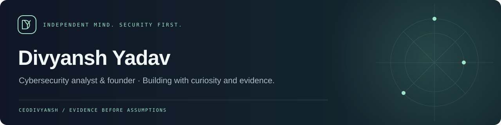

## Security work should explain its evidence.

I’m **Divyansh Yadav**, founder of **BITTU ICLOUD**, based in Rajasthan, India. I’m building practical cybersecurity skills through small tools, reproducible examples, and clear reports.

My focus is **defensive investigation**, **email triage**, **file integrity**, and **incident communication**. The projects below use synthetic data and make their limitations explicit.

[Portfolio](https://ceodivyansh.com) · [LinkedIn](https://www.linkedin.com/in/ceodivyansh/) · [Email](mailto:divyansh@bittuicloud.com)

### Selected projects

| Project | What you can review | Built with |
| --- | --- | --- |
| [Sentinel log triage](https://github.com/PROxZONE/sentinel-log-triage) | Rolling-window authentication analysis, contextual findings, JSON and Markdown outputs | Python |
| [Mail header inspector](https://github.com/PROxZONE/mail-header-inspector) | Sender-domain observations and untrusted authentication claims, without sending data anywhere | Python |
| [File integrity watch](https://github.com/PROxZONE/file-integrity-watch) | SHA-256 baselines with changed, added, and missing file reports | Python |
| [Incident response notebook](https://github.com/PROxZONE/incident-response-notebook) | UTC timeline generation, evidence registers, and reusable investigation templates | Python + Markdown |

### How I approach a project

**Observe → validate → explain → improve.**

- Keep the scope clear and use authorized, sanitized data.
- Make examples reproducible and test behavior that matters.
- Separate facts, assumptions, and missing evidence.
- Finish with a practical next step.

### Currently developing

Hands-on lab documentation, stronger detection logic, and concise security reporting. Completed labs and credentials belong alongside supporting evidence; these repositories do not claim real client investigations or production deployments.

---

**Open to conversations about cybersecurity roles, collaboration, and thoughtful security tools.**
